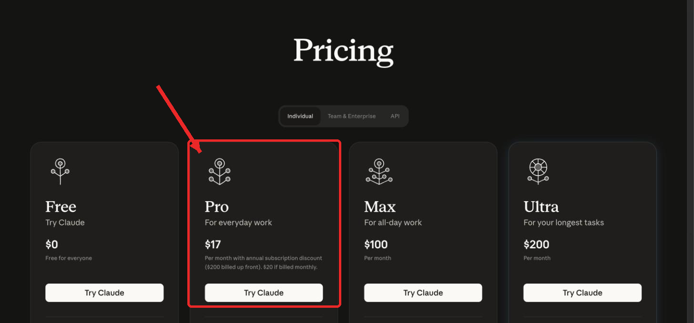
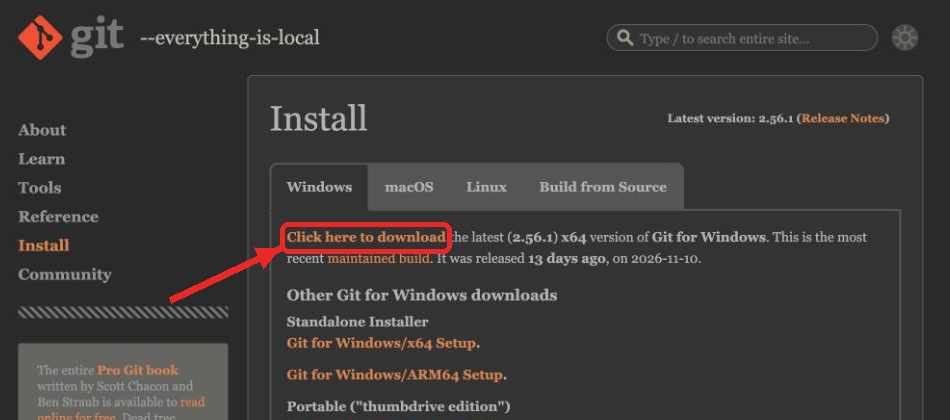
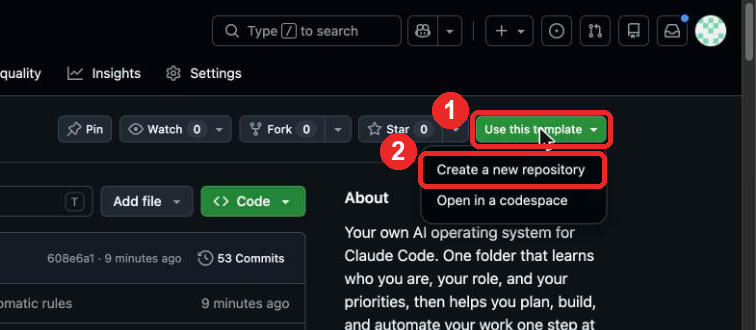
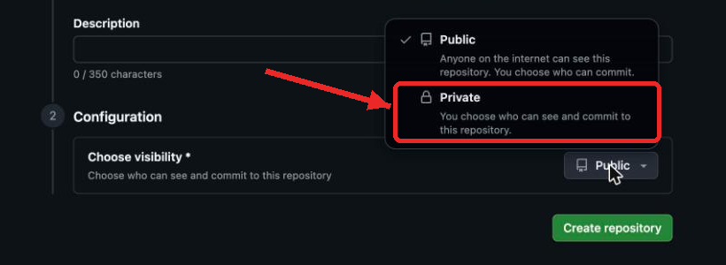

# Start here: your AI OS from zero

This guide takes you from nothing to a working AI OS on your computer and your phone. Do the parts in order. Each step is one thing to click or type. Plan on about an hour.

| Part | What you do | Time |
|---|---|---|
| 1 | Make your accounts | 10 min |
| 2 | Install VS Code | 5 min |
| 3 | Install Git | 5 min |
| 4 | Install Claude Code and sign in | 5 min |
| 5 | Make your own copy and open it | 10 min |
| 6 | Put it on your phone | 10 min |
| 7 | Connect to your company's layer (only if your company has one) | 5 min |
| 8 | Build it out | ongoing |

---

## Part 1: Make your accounts

### GitHub (where your AI OS is stored)

**Got an invite email from your company's GitHub?** Click **Join** in that email and follow it. If you don't have a GitHub account yet, it walks you through making one. Then skip to Claude below.

**No account yet:**

1. Go to **github.com/signup**.
2. Type your work email, make a password, pick a username.
3. Check your email for the code GitHub sends and type it in.
4. Send your username to whoever runs GitHub at your company so they can add you.

**Already have a GitHub account:** sign in at **github.com** and send your username to whoever runs GitHub at your company so they can add you.

### Claude (the AI that runs your AI OS)

Follow the one that matches you.

**Your company sent you an invite**

1. Open the email from Anthropic and click **Accept invite**.
2. Sign in with your work email.
3. Your account is ready. Your company covers the plan.

**Your company has you sign up yourself**

1. Go to **claude.ai** and click **Sign up**.
2. Sign up with your work email.
3. Choose the **Pro** plan.

**You already have a Claude account with your work email**

1. Go to **claude.ai** and log in.
2. Check your plan. If it says **Free**, upgrade to **Pro**. Pro or higher, you're all set.

Already have a personal Claude account? Keep it for personal use and follow one of the options above with your work email.

---

## Part 2: Install VS Code (the app your AI OS opens in)

1. Go to **code.visualstudio.com**.
2. Click the big blue **Download** button. It already knows if you're on Windows or Mac.

**On Windows:** open the file you downloaded. Click **I accept the agreement**, then **Next** on every screen, then **Install**, then **Finish**.

**On a Mac:** open the file you downloaded. Drag **Visual Studio Code** into your **Applications** folder. Open it from Applications. If the Mac asks "are you sure you want to open it?", click **Open**.

---

## Part 3: Install Git (what keeps your folder in sync with GitHub)

**On Windows:**

1. Go to **git-scm.com/downloads/win**.
2. Click **Click here to download**.

3. Open the file you downloaded. Click **Next** on every screen without changing anything, then **Install**, then **Finish**. The default choices are the right ones.

**On a Mac:**

1. Open the **Terminal** app (press Cmd+Space, type **Terminal**, press Enter).
2. Type `git --version` and press Enter.
3. If a box pops up asking to install developer tools, click **Install** and wait for it to finish. If it shows a version number instead, Git is already installed.

---

## Part 4: Install Claude Code and sign in

1. Open **VS Code**.
2. On the far left there's a column of icons. Click the one that looks like **four small squares**. That's **Extensions**.
3. In the search box at the top, type **Claude Code**.
4. Click the one made by **Anthropic**, then click the blue **Install** button.
5. When it finishes, a **Claude** icon (a spark) shows up in the column of icons on the far left, right under the four squares. Click it. The Claude panel opens.
6. Click **Sign in**, then pick **Claude.ai subscription**.
7. Your web browser opens. Click **Authorize**. Go back to VS Code. You're signed in.

---

## Part 5: Make your own copy and open it

### Make your copy on GitHub

1. Go to **github.com/masondoberstein/AI-Operating-System-RizeTech**.
2. Click the green **Use this template** button, then **Create a new repository**.

3. Fill in the page:
   - **(1) Owner:** pick your company, not your own name.
   - **(2) Repository name:** something like `yourname-ai-os`.
   - **(3) Visibility:** click it and pick **Private**. Never leave it on Public.
   - **(4)** Click **Create repository**.

   If your company isn't in the **Owner** list, or **Private** isn't an option, your company hasn't turned on repo creation for employees yet. Ask whoever runs GitHub at your company to turn it on or make the repo for you.

4. On your new copy's page, click the green **Code** button, then click the **copy** icon next to the link.

### Open it in VS Code

1. In VS Code, click the icon on the left that looks like a **branch** (three dots connected by lines). That's **Source Control**.
2. Click **Clone Repository**.
3. Paste the link you copied (Ctrl+V on Windows, Cmd+V on a Mac) and press Enter.
4. A box asks where to save it. Pick **Documents**, then click **Select as Repository Destination**.
5. A box asks to sign in to GitHub. Click **Allow**, then **Authorize** in the browser, then go back to VS Code.
6. When it says the clone is done, click **Open**.
7. VS Code asks "Do you trust the authors of the files in this folder?" Click **Yes, I trust the authors**. This one matters: if you skip it, VS Code opens in **Restricted Mode** and turns Claude off.
8. In the column of icons on the far left, click the **Claude** spark (right under the four squares). The Claude panel opens. Your AI OS is ready.

   **Don't see the Claude spark?** Look for **Restricted Mode** in a blue bar at the top or in the bottom left corner. Click **Manage**, then **Trust**. The spark comes back.

   **A "Chat" panel opened on the right?** That's VS Code's own AI (Copilot), not Claude. Close it with the **X**.

---

## Part 6: Put it on your phone

Your AI OS lives in one place: your private copy on GitHub. Your computer has a copy, and your phone works on that same GitHub copy. Claude pulls the newest version when it starts and saves to GitHub after every reply, so everything stays matched.

There are two ways to use it from your phone. Set up both.

| | Way 1: Remote Control | Way 2: Cloud session |
|---|---|---|
| What it is | Your phone drives the chat running on your computer | Your phone runs a chat in Anthropic's cloud, no computer needed |
| Computer | Must be on (it reconnects on its own after sleep) | Can be off |
| What it can reach | Everything on your computer, including your connected tools and keys | Only what's in your GitHub copy |
| Use it when | You step away from your desk | Your computer is off, or you only have a phone |

### First: get the Claude app

1. On your phone, download the **Claude** app (App Store on iPhone, Google Play on Android).
2. Sign in with the **same** Claude account you used on your computer.

### Way 1: Remote Control (set up once)

1. In VS Code, in the Claude panel, type `/` to open the command menu.
2. Go to **Settings** and turn on **Enable Remote Control for all sessions**.
3. That's it. From now on, every chat you start on your computer also shows up on your phone.

**Using it:** on your phone, open the Claude app, tap **Code**, and tap the chat with the **laptop** icon. Type like normal.

**If a chat doesn't show up on your phone:** it was started before you turned the setting on. In that chat on your computer, type `/rc` and press Enter.

### Way 2: Cloud session (set up once)

1. In the Claude app, tap **Code**.
2. Tap to connect **GitHub**, sign in, and allow it to see your AI OS copy.

**Using it:**

1. In **Code**, start a new session and pick your AI OS copy.
2. Type what you need. A **cloud** icon means it's running in the cloud, not on your computer.
3. When it's done, check that the change landed on your main copy. If it went to a separate branch, tell Claude "merge this into main".
4. Next time you open VS Code, your computer pulls the change in on its own.

A cloud session can't use anything that needs a key saved on your computer, like sending through a connected tool. Use Way 1 for that.

---

## Part 7: Connect to your company's layer (only if your company has one)

Some companies set up one shared layer everyone connects to: the company handbook (what the company does, who's who, the words and systems) and shared skills. If yours has one, whoever runs AI at your company gives you access. Then, in Claude Code, type `/connect-company` and follow along.

No company layer? Skip this. Your AI OS works fine on its own.

---

## Part 8: Build it out

You can do all of this from your computer or your phone.

1. **Today: type `/onboard`.** It asks 7 questions about you, your job, your company, and how you write. Answer honestly. When it asks for writing samples, paste real emails, don't describe them. About 15 minutes.
2. **This week: use it for real work.** Bring real questions. Ask it to save important decisions.
3. **Any time you're lost: type `/next-step`.** It checks your folder and tells you exactly what to do next.
4. **Day 7: type `/audit`.** It scores your AI OS and names the biggest gap.
5. **Day 14: type `/level-up`.** It finds the first job worth handing off, then `/make-a-skill` builds it.
6. **Keep going:** `guides/SETUP-GUIDE.md` walks through all four layers (Context, Connections, Capabilities, Cadence).

---

## Pop ups you'll see once (and what to click)

| When | What it says | Click |
|---|---|---|
| Opening VS Code on a Mac | "Are you sure you want to open it?" | **Open** |
| Cloning your copy | "The extension GitHub wants to sign in" | **Allow**, then **Authorize** in the browser |
| Opening your folder | "Do you trust the authors?" | **Yes, I trust the authors** |
| Signing into Claude Code | Browser opens to Claude | **Authorize** |
| Claude wants to run something new | "Do you want to proceed?" | **Yes, and don't ask again** (only for things in your own folder) |

Your AI OS comes set up so Claude can edit files in your folder and save to GitHub without asking every time. It still asks before anything outside your folder.

---

## You're done with setup when

- [ ] You have a GitHub account and a paid Claude account
- [ ] VS Code, Git, and Claude Code are installed, and you're signed in
- [ ] Your private copy is open in VS Code
- [ ] A chat from your computer shows up on your phone (Way 1)
- [ ] You started a cloud session from your phone (Way 2)
- [ ] Connected to your company's layer, if it has one
- [ ] `/onboard` is finished

---

## For IT and admins

Approve these once and every new person is just this checklist:

- **GitHub:** a seat in the company GitHub for each person. Let employees make their own private repos (organization **Settings**, then **Member privileges**, then **Repository creation**: check **Private** only). Install the **Claude GitHub app** on the company GitHub so cloud sessions (Way 2) work. Owners of the company GitHub can see every private repo, so tell employees who that is.
- **Claude:** which plan people use (Pro, Team, or Enterprise) and who pays. On Team or Enterprise, an owner turns on **Claude Code**, **Remote Control**, and **cloud sessions** in the admin settings.
- **Laptops:** permission to install VS Code, Git, and the Claude Code extension. IT can also push Claude Code settings to every laptop at once (managed settings) so nobody sets them by hand.
- **Connections:** which company systems (email, calendar, files, chat) people's AI OS may connect to, and who approves each one.
