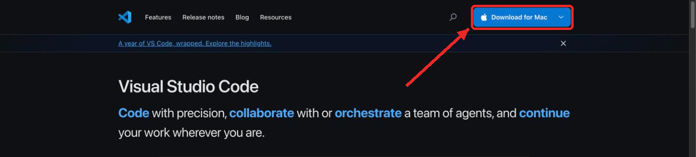
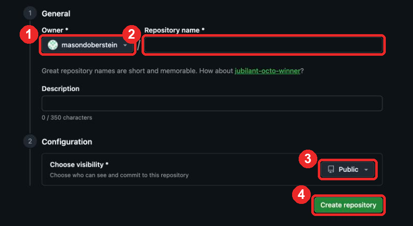
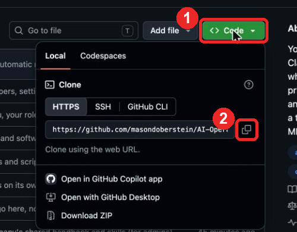

# Start here: your AI OS from zero

Follow these parts in order. About an hour from nothing to a working AI OS on your computer and phone.

1. Make your accounts
2. Install VS Code
3. Install Git
4. Install Claude Code
5. Make your copy and open it
6. Put it on your phone
7. Connect to your company's layer
8. Build it out

---

## Part 1: Make your accounts

### GitHub (where your AI OS is stored)

- **Got an invite email from your company's GitHub?** Click **Join** and follow it.
- **No account:** sign up at **github.com/signup** with your work email, then send your username to whoever runs GitHub at your company.
- **Already have one:** sign in at **github.com** and send your username to whoever runs GitHub at your company.

### Claude (the AI)

- **Got an invite email from Anthropic?** Click **Accept invite** and sign in with your work email. Your company covers the plan.
- **No invite:** sign up at **claude.ai** with your work email and choose **Pro**.
- **Already have an account with your work email:** log in at **claude.ai**. If your plan says **Free**, upgrade to **Pro**.

Keep any personal Claude account for personal use. Use your work email here.

---

## Part 2: Install VS Code (the app your AI OS opens in)

Go to **code.visualstudio.com** and click **Download**.

- **Windows:** open the download, accept the agreement, click **Next** on every screen, then **Install**.
- **Mac:** open the download and drag **Visual Studio Code** into **Applications**. Open it. If asked "are you sure?", click **Open**.

---

## Part 3: Install Git (keeps your folder synced with GitHub)

- **Windows:** go to **git-scm.com/downloads/win**, click **Click here to download**, open it, and click **Next** on every screen without changing anything.

  

- **Mac:** open the **Terminal** app, type `git --version`, and press Enter. If a box asks to install developer tools, click **Install**.

---

## Part 4: Install Claude Code

1. Open **VS Code**. In the column of icons on the far left, click the **four small squares** (Extensions).
2. Search **Claude Code**, pick the one by **Anthropic**, and click **Install**. If it asks whether you trust the publisher, click **Trust Publisher & Install**.
3. A **Claude** spark appears in the left column, under the four squares. Click it, click **Sign in**, and pick **Claude.ai subscription**.
4. Your web browser opens to Claude. Make sure it's signed in with your **work email** (if it shows a personal account, log out and back in). Click **Authorize**.
5. If the browser asks to open Visual Studio Code, click **Open**. If it shows a code instead, copy it and paste it into VS Code.

---

## Part 5: Make your copy and open it

### Make your copy

1. Go to **github.com/masondoberstein/AI-Operating-System-RizeTech**.
2. Click **Use this template**, then **Create a new repository**.

   

3. Set **(1) Owner** to your company, **(2)** give it a name like `yourname-ai-os`, set **(3) visibility** to **Private**, and click **(4) Create repository**.

   

   Your company not in the Owner list, or no Private option? Ask whoever runs GitHub at your company.

4. On your new copy, click **Code**, then the **copy** icon.

   

### Open it in VS Code

1. In VS Code's left column, click the **branch** icon (Source Control), then **Clone Repository**.
2. Paste the link, press Enter, and pick **Documents** as the place to save it.
3. If asked to sign in to GitHub, click **Allow**, then **Authorize** in the browser.
4. Click **Open**, then **Yes, I trust the authors**.
5. Click the **Claude** spark in the left column. Type to Claude in the box at the bottom. You're in.

**No Claude spark, or a blue "Restricted Mode" bar?** Press **Ctrl+Shift+P** (Windows) or **Cmd+Shift+P** (Mac), type **Manage Workspace Trust**, press Enter, and click **Trust**. Then press Ctrl/Cmd+Shift+P again, type **Reload Window**, and press Enter.

**A "Chat" panel on the right?** That's VS Code's own AI, not Claude. Close it.

---

## Part 6: Put it on your phone

Install the **Claude** app on your phone and sign in with the same account. Then set up both ways:

**Way 1: Remote Control (your phone drives your computer).** In the Claude panel, type `/`, go to **Settings**, and turn on **Enable Remote Control for all sessions**. Every chat on your computer now shows up in the app under **Code** with a laptop icon. Your computer has to be on.

**Way 2: Cloud (no computer needed).** In the app, tap **Code**, connect **GitHub**, and start a session on your AI OS copy. When it's done, check the change landed on main. If not, tell Claude "merge this into main". Your computer pulls it in next time you open VS Code. Cloud sessions can't use keys saved on your computer.

---

## Part 7: Connect to your company's layer

If your company set one up, whoever runs AI there gives you access. Then type `/connect-company` in Claude. No company layer? Skip this.

---

## Part 8: Build it out

- **Today:** type `/onboard`. Seven questions about you and your job, about 15 minutes. Paste real emails when it asks for writing samples.
- **Lost any time:** type `/next-step`.
- **Day 7:** `/audit`. **Day 14:** `/level-up`.
- **Going further:** `guides/SETUP-GUIDE.md`.

---

## Optional: Claude in the terminal

Same Claude, same folder, just a terminal instead of the panel.

**Easiest (nothing to install):** press **Ctrl+,** or **Cmd+,**, search **Claude Code use terminal**, and check the box.

**Full terminal:**

1. In VS Code, click **Terminal** at the top of the screen, then **New Terminal**.
2. Paste the install line and press Enter.
   - Mac: `curl -fsSL https://claude.ai/install.sh | bash`
   - Windows: `irm https://claude.ai/install.ps1 | iex`
3. Paste the line that lets your computer find Claude and press Enter.
   - Mac: `echo 'export PATH="$HOME/.local/bin:$PATH"' >> ~/.zshrc`
   - Windows: `[Environment]::SetEnvironmentVariable('PATH', [Environment]::GetEnvironmentVariable('PATH','User') + ";$env:USERPROFILE\.local\bin", 'User')`
4. Quit VS Code completely (Cmd+Q on Mac, close every window on Windows) and reopen it.
5. Open a new terminal and type `claude`. Sign in with **Authorize** the first time. For Remote Control, type `/config` and turn it on there.

**"Not recognized" or "command not found":** do steps 3 and 4 again. **"Access denied" or blocked:** send IT the exact message and use the easiest option meanwhile.

---

## For IT and admins

Approve these once and every new person just follows this guide:

- **GitHub:** a seat for each person. Let members create **Private** repos only (organization **Settings**, **Member privileges**, **Repository creation**). Install the **Claude GitHub app** on the organization so cloud sessions work. Organization owners can see every private repo, so tell people who that is.
- **Claude:** which plan people use and who pays. On Team or Enterprise, turn on **Claude Code**, **Remote Control**, and **cloud sessions** in the admin settings.
- **Laptops:** allow VS Code, Git, and the Claude Code extension, or push them to laptops yourself so employees can skip Parts 2 to 4. For the terminal, allow downloads from `claude.ai` and the program at `%USERPROFILE%\.local\bin\claude.exe` (Windows) or `~/.local/bin/claude` (Mac). No admin rights needed.
- **Connections:** which company systems (email, calendar, files, chat) people may connect, and who approves each.
